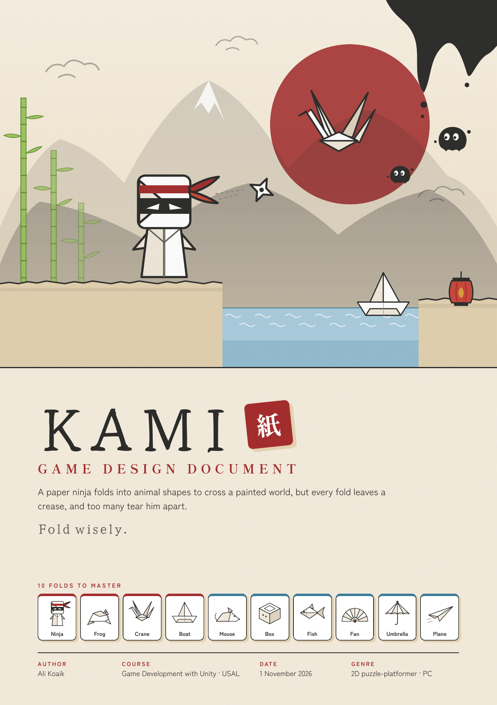
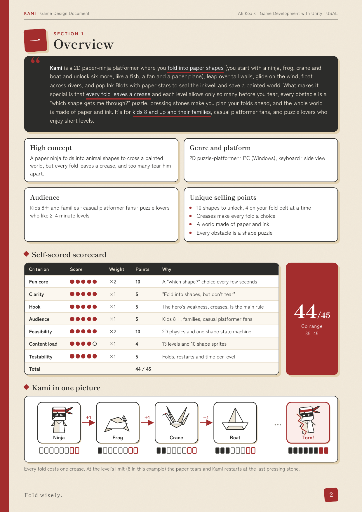
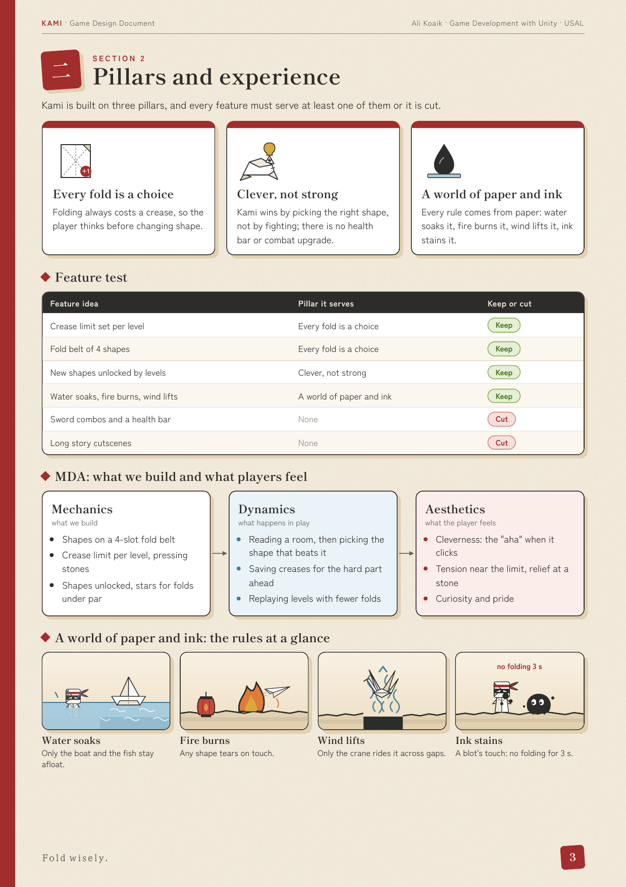
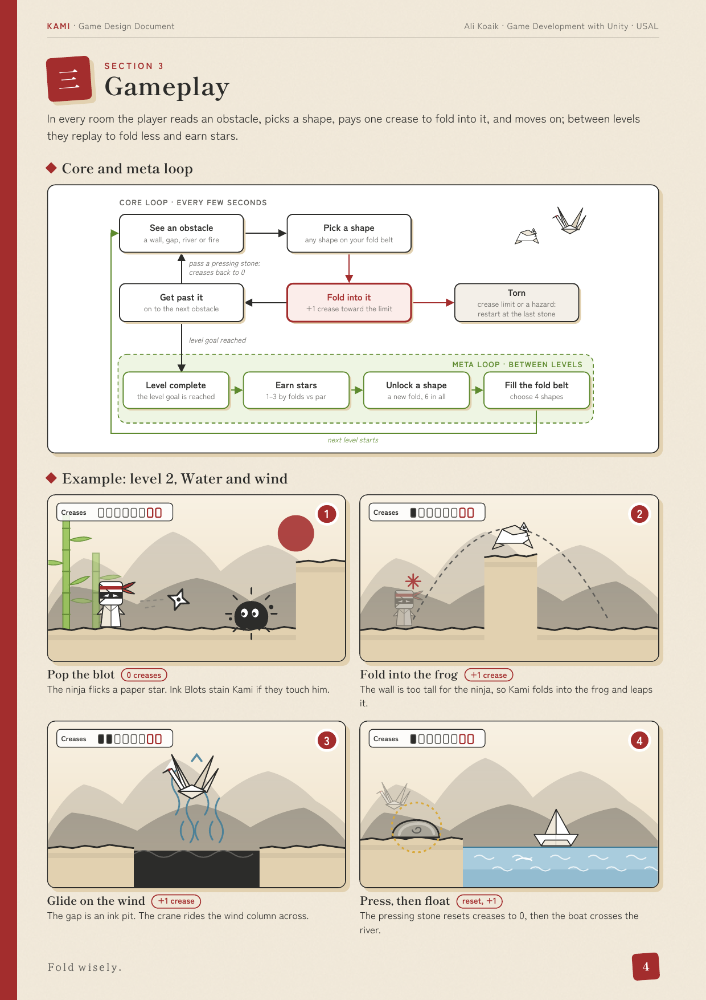
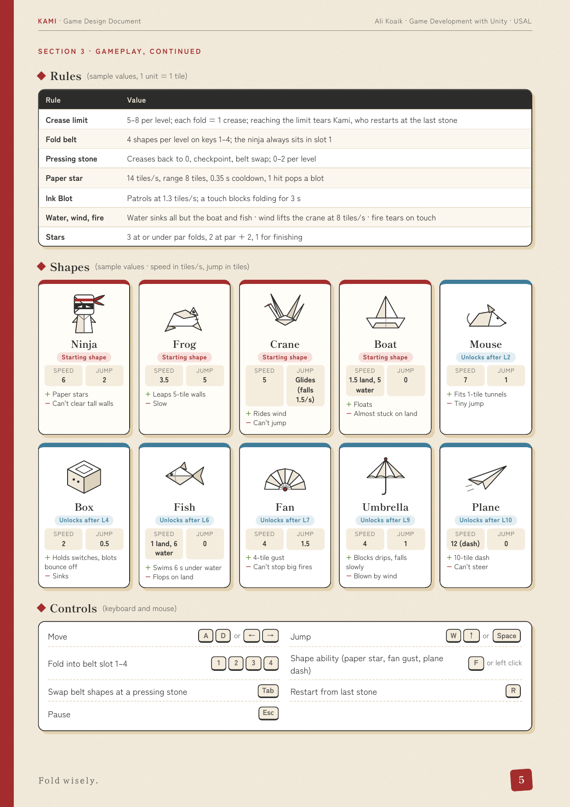
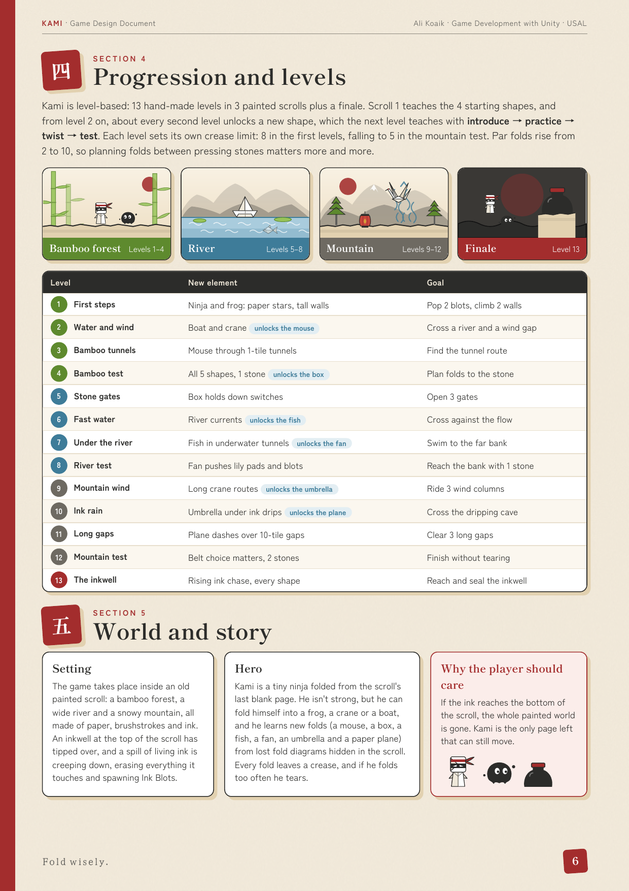
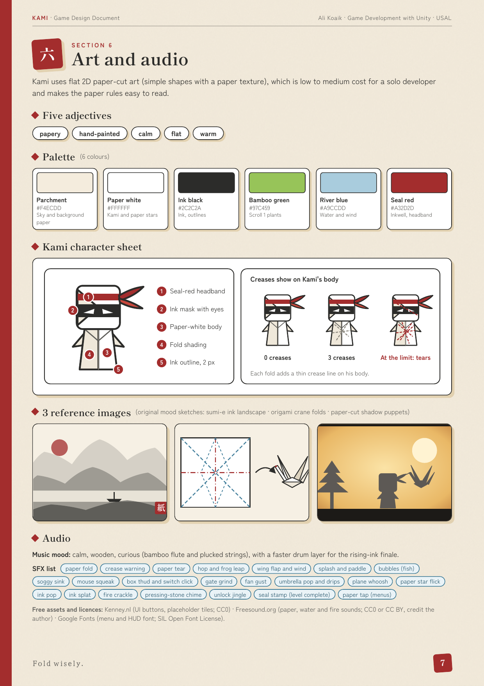
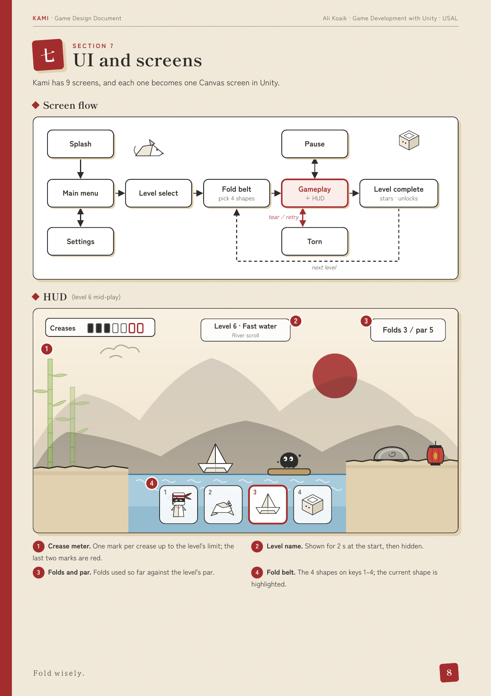
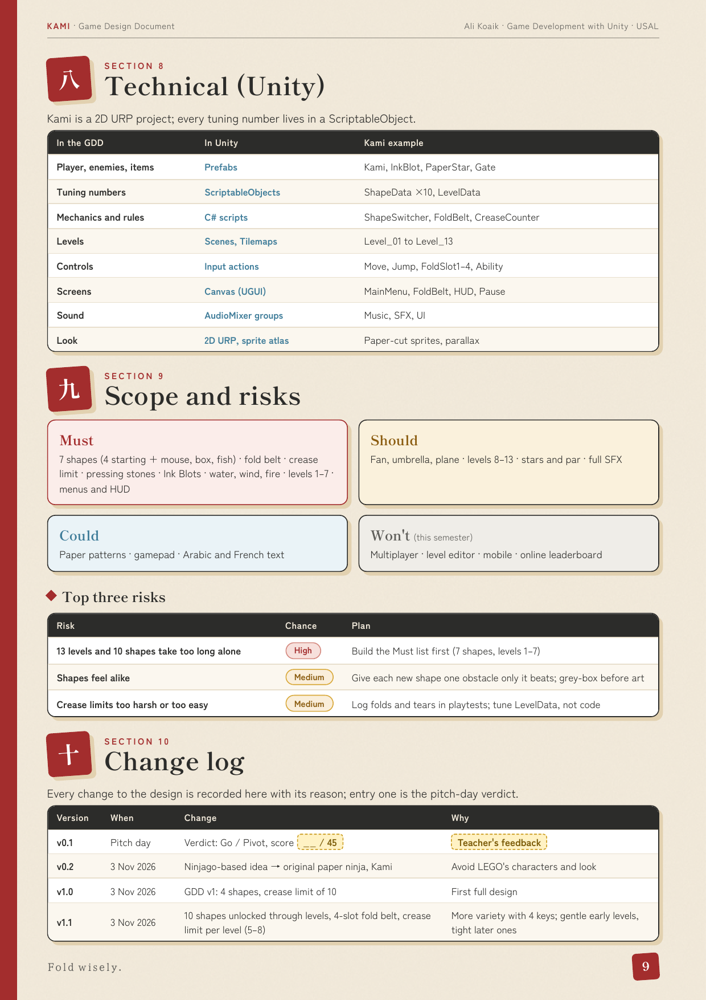
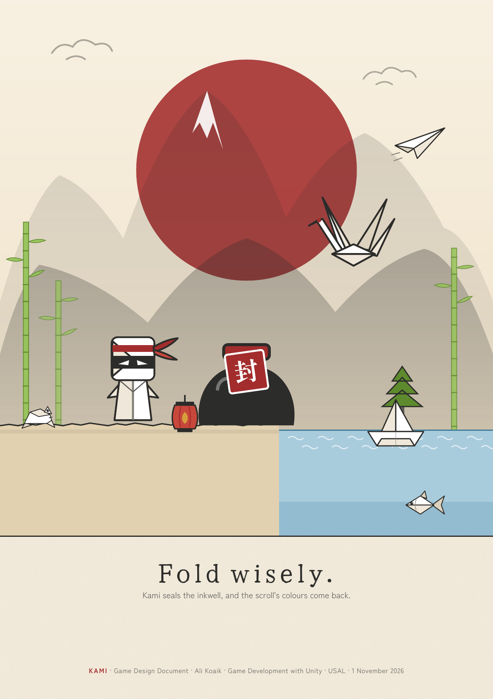

<!-- Kami — Game Design Document. Pages rendered 1:1 from Kami_GDD.pdf -->

  

  <b>1</b> <a href="#overview">Overview</a> ·
  <b>2</b> <a href="#pillars-and-experience">Pillars</a> ·
  <b>3</b> <a href="#gameplay">Gameplay</a> ·
  <b>4–5</b> <a href="#progression-levels-world-and-story">Levels &amp; Story</a> ·
  <b>6</b> <a href="#art-and-audio">Art &amp; Audio</a> ·
  <b>7</b> <a href="#ui-and-screens">UI</a> ·
  <b>8–10</b> <a href="#technical-scope-and-change-log">Tech, Scope &amp; Log</a> ·
  <a href="Kami_GDD.pdf">PDF</a>

<h2 id="overview">Overview</h2>

<h2 id="pillars-and-experience">Pillars and experience</h2>

<h2 id="gameplay">Gameplay</h2>

<h2 id="progression-levels-world-and-story">Progression, levels, world and story</h2>

<h2 id="art-and-audio">Art and audio</h2>

<h2 id="ui-and-screens">UI and screens</h2>

<h2 id="technical-scope-and-change-log">Technical, scope and change log</h2>

KAMI · Game Design Document · Ali Koaik · Game Development with Unity · USAL · 1 November 2026

